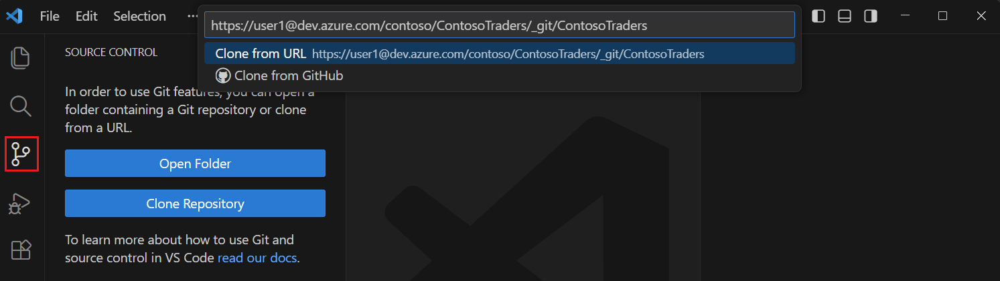
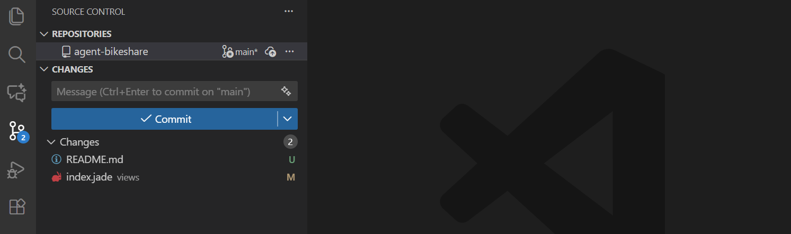
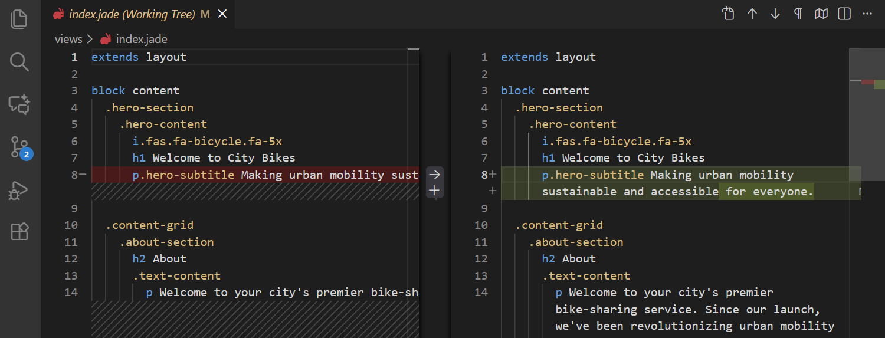
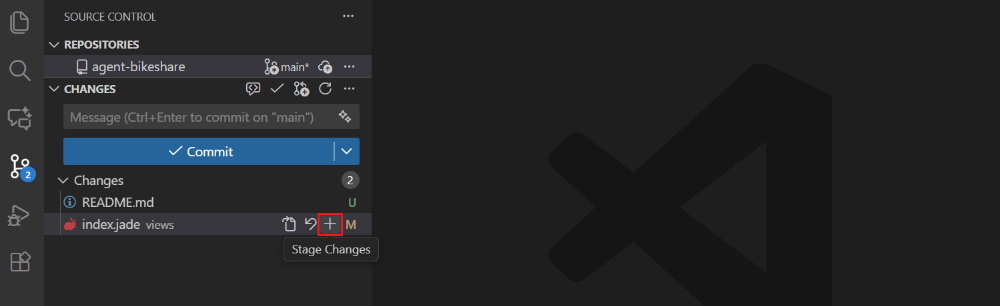
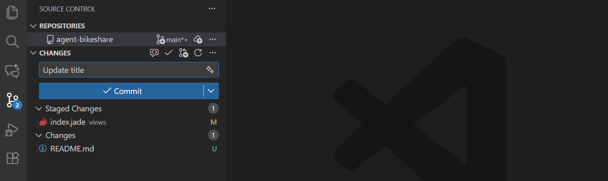
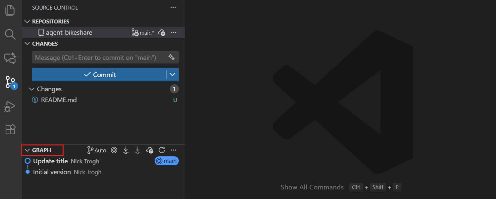
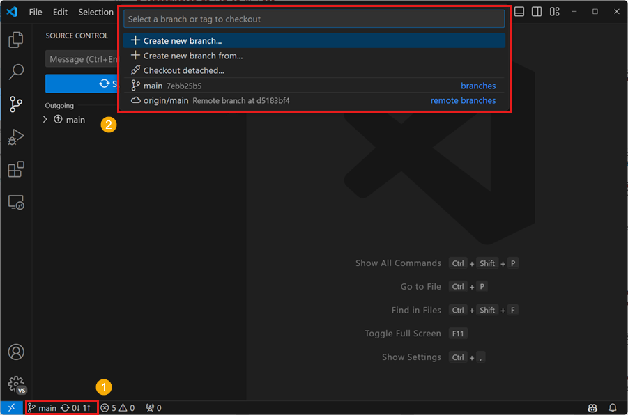
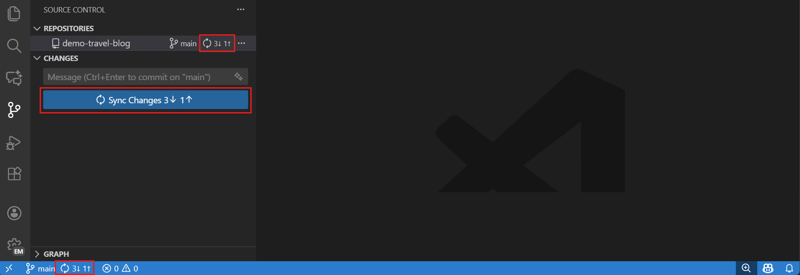
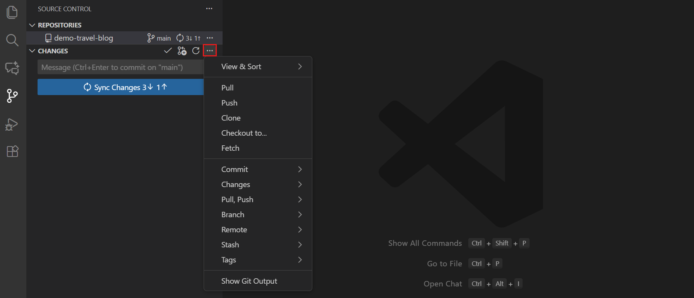
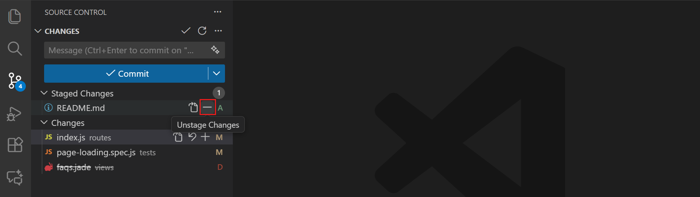

# Session 1 · Part B: Git + GitHub in VS Code

**Goal:** save your work in checkpoints, try ideas safely, and undo mistakes, using the **Source Control** panel in VS Code.

**Time:** about 90 minutes · **Practice file:** `main.py` from Part A

---

## 1. The idea

- **Git** = save points for your project. If something breaks, you go back.
- **GitHub** = an online copy of your project.

```
Your files  ──Commit──►  Checkpoints (history)  ──Sync──►  GitHub
```

> **No commit = no save point.** Git can't bring back work you never committed.

| Word | Meaning |
|---|---|
| **Commit** | One checkpoint |
| **Diff** | What changed |
| **Branch** | A safe copy for trying ideas |
| **Clone** | Download a project |
| **Pull / Push** | Get changes from GitHub / send yours to GitHub |

---

## 2. Setup (only once)

Install **Git** and **VS Code**. Then in VS Code, open **Terminal → New Terminal** and type:

```bash
git config --global user.name "Your Name"
git config --global user.email "you@example.com"
```

That's the only terminal step. Everything else is clicks.

---

## 3. Clone the project

1. Click the **Source Control** icon on the left (or press `Ctrl+Shift+G`).
2. Click **Clone Repository**.
3. Paste `https://github.com/Yousefeslam214/python.git` and press **Enter**.
4. Choose a folder, then click **Open**.



---

## 4. Save a checkpoint (every time you work)

### ① Change

Open `main.py`, change `name = "Yousef"` to your name, and **save** (`Ctrl+S`).

### ② Look

Source Control shows the changed files. The letter tells you what happened:
**M** = modified · **U** = new file · **D** = deleted



### ③ Read the diff

**Click the file.** **Left** = before, with **red** for removed lines. **Right** = now, with **green** for added lines.



> **Always read the diff before you commit.**

### ④ Stage

Hover over the file and click **+** (Stage Changes).



### ⑤ Commit

Type a short message and click **✓ Commit**.



> Forgot to stage? VS Code asks if it should stage everything. Click **Yes**.

### ⑥ See your history

Open **Graph** at the bottom of the panel. Your newest commit is at the top.



**Good habits:** small commits · clear messages (`Fix tax calculation`, not `update`) · commit **before** risky changes.

---

## 5. Branches: try ideas safely

1. Click the **branch name** at the bottom-left ①.
2. Choose **+ Create new branch…** ②, type `try-discount`, and press **Enter**.



3. Change `quantity = 3` to `quantity = 5`, save, and commit.
4. Click the branch name and pick **main**. Your change is gone. Pick **try-discount** again and it's back.

**Happy with it?** Switch to **main**, then **… → Branch → Merge…** and pick `try-discount`.

---

## 6. Pull and push (Sync)

After you commit, the button changes to **Sync Changes**.
**↓** = changes to get · **↑** = your commits to send. One click does both.



- **First time:** VS Code asks you to sign in to GitHub. Click **Allow**.
- **New branch:** the button says **Publish Branch** instead.
- **Only get updates:** **… → Pull**. Do this **before** you start working.



---

## 7. Undo mistakes



| Problem | Click |
|---|---|
| Undo my changes to a file | Hover the file → **↶** (Discard Changes) |
| Undo **all** my changes | Hover **Changes** → **↶** (Discard All Changes) |
| I staged a file by mistake | Hover it → **−** (Unstage) |
| I committed by mistake (not synced yet) | **… → Commit → Undo Last Commit** |
| I'm on the wrong branch | Click the branch name → pick the right one |
| I already synced a bad commit | **Ask your teacher** |

> ⚠️ **Discard is forever.** Read the diff first.

**Stop and ask your teacher** if you see **IRREVERSIBLE**, **DELETE**, **Force**, or a **conflict** (a file marked **!**).

---

## 8. Checking AI edits

When an AI tool (like Claude Code) changes your files:

1. **Commit** first, so you have a checkpoint.
2. Let the AI make its change.
3. **Click every changed file** and read the diff.
4. **Run the code.**
5. Good → **Commit**. Bad → **Discard All Changes**.

---

## 9. Keep secrets out

**Never commit passwords, API keys, or customer data.**
The `.gitignore` file lists files Git should ignore. More in Session 4.

---

## 10. Good to know: the same actions as commands

AI tools and error messages use these words:

| In VS Code | Command |
|---|---|
| Clone Repository | `git clone` |
| Changes list | `git status` |
| Click a file (diff) | `git diff` |
| **+** Stage | `git add` |
| **✓** Commit | `git commit` |
| Graph | `git log` |
| Create new branch | `git switch -c` |
| Pull / Sync | `git pull` / `git push` |
| ↶ Discard | `git restore` |

---

## 11. Homework

1. Change `price` in `main.py`, read the diff, and **commit**.
2. Make a branch called `practice`, change something, commit, and switch between branches.
3. Delete 5 lines, save, then **↶ Discard** to bring them back.
4. Make a commit, then **Undo Last Commit**. What happened?
5. In your own words: what's the difference between *your files* and *the history*?

---

<sub>Screenshots: [Visual Studio Code documentation](https://code.visualstudio.com/docs/sourcecontrol/overview) © Microsoft, licensed under [CC BY 3.0 US](https://creativecommons.org/licenses/by/3.0/us/). The screenshots show a sample project; your file names will be different.</sub>
