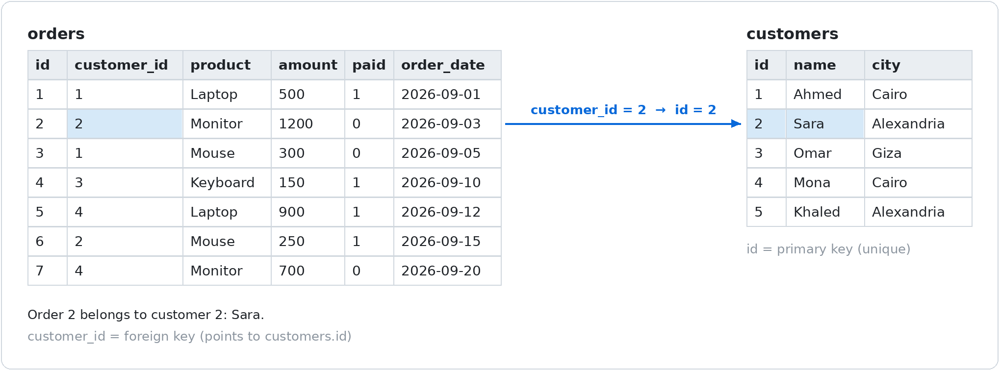
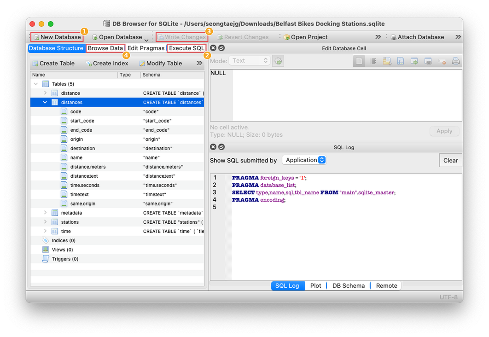
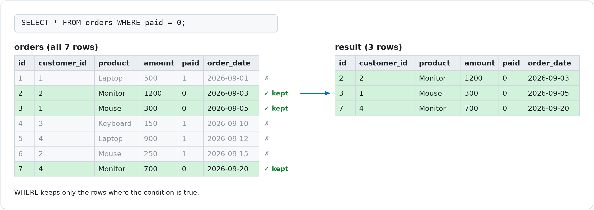
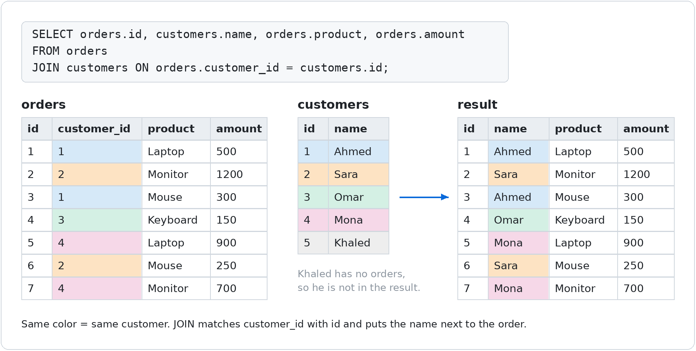
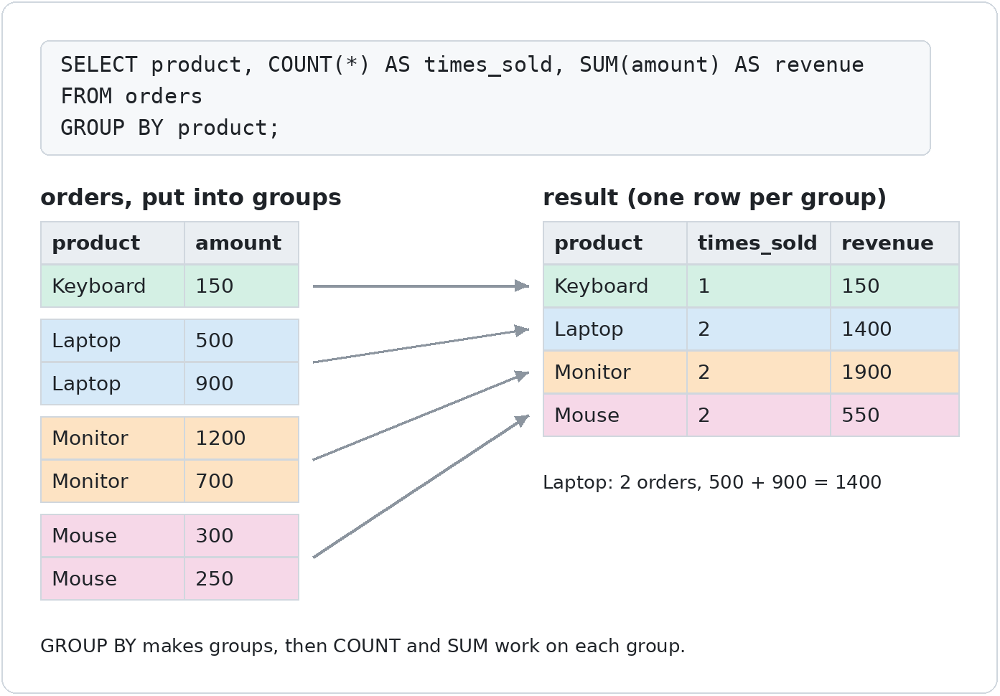

# Session 2 · Part B: SQL & Databases

**Goal:** understand how business data is stored, and answer business questions with `SELECT`, `WHERE`, `JOIN` and `GROUP BY`.

**Time:** about 90 minutes · **Tool:** DB Browser for SQLite (free)

---

## 1. The idea

A database stores data in **tables**. A table looks like an Excel sheet.

| Word | Meaning |
|---|---|
| **Table** | A group of one kind of thing: `customers`, `orders` |
| **Row (record)** | One thing, like one customer |
| **Column** | One piece of information, like `name` or `city` |
| **id (primary key)** | A unique number for each row |
| **Foreign key** | A column that points to an `id` in another table |

Our practice database has **2 tables**. Each order says **which customer** it belongs to:



> **Link to Part A:** the `orders` list in `main.py` is a table. Each dictionary is one row.
> **Link to Odoo:** Odoo works the same way. Customers are in the `res_partner` table and sales orders are in `sale_order`.

---

## 2. Setup (only once)

1. Install **DB Browser for SQLite** from **sqlitebrowser.org**.
2. Click **New Database** ①, save it as `practice.db`, and close the "Edit table" window that opens.
3. Open the **Execute SQL** tab ②, paste the setup code below, and press **▶ Run** (or `Ctrl+Enter`).
4. Click **Write Changes** ③ (or `Ctrl+S`).
5. Open **Browse Data** ④ to see your tables.



**Setup code** (copy all of it):

```sql
CREATE TABLE customers (
    id   INTEGER PRIMARY KEY,
    name TEXT,
    city TEXT
);

CREATE TABLE orders (
    id          INTEGER PRIMARY KEY,
    customer_id INTEGER,
    product     TEXT,
    amount      INTEGER,
    paid        INTEGER,
    order_date  TEXT
);

INSERT INTO customers (id, name, city) VALUES
    (1, 'Ahmed',  'Cairo'),
    (2, 'Sara',   'Alexandria'),
    (3, 'Omar',   'Giza'),
    (4, 'Mona',   'Cairo'),
    (5, 'Khaled', 'Alexandria');

INSERT INTO orders (id, customer_id, product, amount, paid, order_date) VALUES
    (1, 1, 'Laptop',   500,  1, '2026-09-01'),
    (2, 2, 'Monitor',  1200, 0, '2026-09-03'),
    (3, 1, 'Mouse',    300,  0, '2026-09-05'),
    (4, 3, 'Keyboard', 150,  1, '2026-09-10'),
    (5, 4, 'Laptop',   900,  1, '2026-09-12'),
    (6, 2, 'Mouse',    250,  1, '2026-09-15'),
    (7, 4, 'Monitor',  700,  0, '2026-09-20');
```

> From now on, write every query in the **Execute SQL** tab ② and press **▶**.
> In the `paid` column, **1 = yes** and **0 = no**.

---

## 3. SELECT: get data

```sql
SELECT * FROM customers;                    -- * = all columns
SELECT name, city FROM customers;           -- only these columns
SELECT * FROM orders ORDER BY amount DESC;  -- sort, biggest first
SELECT * FROM orders LIMIT 3;               -- only 3 rows
```

**Rules:** put text in 'single quotes' · end every query with `;` · `--` starts a comment (like `#` in Python).

---

## 4. WHERE: keep only some rows



| SQL | Meaning |
|---|---|
| `=` | equal (Python uses `==`) |
| `!=` | not equal |
| `>` `<` `>=` `<=` | bigger / smaller |
| `AND` | both conditions are true |
| `OR` | at least one condition is true |

```sql
SELECT * FROM customers WHERE city = 'Cairo';
SELECT * FROM orders WHERE amount > 500;
SELECT * FROM orders WHERE paid = 0 AND amount > 500;
```

---

## 5. JOIN: connect two tables

The `orders` table says `customer_id = 2`. **Who is that?** `JOIN` finds out:



```sql
SELECT orders.id, customers.name, orders.product, orders.amount
FROM orders
JOIN customers ON orders.customer_id = customers.id;
```

- `ON …` = **how the tables are related**.
- `orders.amount` = the `amount` column **from the `orders` table**.

---

## 6. GROUP BY: totals per group

| Function | Meaning |
|---|---|
| `COUNT(*)` | how many rows |
| `SUM(amount)` | add up |
| `AVG(amount)` | average |
| `MIN(amount)` / `MAX(amount)` | smallest / biggest |



```sql
SELECT product, COUNT(*) AS times_sold, SUM(amount) AS revenue
FROM orders
GROUP BY product;
```

`AS` gives the result column a clear name.

---

## 7. From a business question to SQL

Before you write SQL, answer **3 questions**:

1. **What** data do I need?
2. **Where** is it? Which tables?
3. **How** are the tables related? Which ids?

> *"How much money do our Cairo customers still owe us?"*
> 1. **What:** amount, paid, city
> 2. **Where:** `orders` and `customers`
> 3. **How:** `orders.customer_id = customers.id`

```sql
SELECT SUM(orders.amount) AS cairo_unpaid
FROM orders
JOIN customers ON orders.customer_id = customers.id
WHERE customers.city = 'Cairo' AND orders.paid = 0;
```

Result: **1000** (Ahmed 300 + Mona 700)

**The parts always come in this order:**
`SELECT` → `FROM` → `JOIN … ON` → `WHERE` → `GROUP BY` → `ORDER BY` → `LIMIT`

---

## 8. Common errors

Read the error like a Python traceback, fix **one** thing, and run again.

| Error | Why | Fix |
|---|---|---|
| `no such table: orderz` | Typo in the table name | `orders` |
| `no such column: nmae` | Typo in the column name | `name` |
| `no such column: Cairo` | Text without quotes | `'Cairo'` |
| `ambiguous column name: id` | Both tables have `id` | `orders.id` or `customers.id` |
| `near "FROM": syntax error` | Extra or missing comma | `SELECT name, city FROM …` |

---

## 9. Safety

- `SELECT` only **reads** data. It is always safe.
- `UPDATE` and `DELETE` **change** data. `DELETE FROM orders;` deletes **every** order.
- With **real company data (Odoo)**: practice on a copy, use read-only access, and never change data without review and a backup.

---

## 10. Practice

Try each question first, then click **Answer** to check.

**1. Show all orders for `Mouse`.**

<details><summary>Answer</summary>

```sql
SELECT * FROM orders WHERE product = 'Mouse';
```
Orders 3 and 6.
</details>

**2. Show customers from Alexandria.**

<details><summary>Answer</summary>

```sql
SELECT * FROM customers WHERE city = 'Alexandria';
```
Sara and Khaled.
</details>

**3. Show paid orders under 500.**

<details><summary>Answer</summary>

```sql
SELECT * FROM orders WHERE paid = 1 AND amount < 500;
```
Orders 4 (150) and 6 (250). Order 1 is exactly 500, so it is not "under 500".
</details>

**4. Show every order with the customer's name and city.**

<details><summary>Answer</summary>

```sql
SELECT orders.id, customers.name, customers.city, orders.product, orders.amount
FROM orders
JOIN customers ON orders.customer_id = customers.id;
```
</details>

**5. Total sales per city?**

<details><summary>Answer</summary>

```sql
SELECT customers.city, SUM(orders.amount) AS total
FROM orders
JOIN customers ON orders.customer_id = customers.id
GROUP BY customers.city;
```
Alexandria 1450, Cairo 2400, Giza 150.
</details>

**6. Who still owes us money, and how much?**

<details><summary>Answer</summary>

```sql
SELECT customers.name, SUM(orders.amount) AS unpaid
FROM orders
JOIN customers ON orders.customer_id = customers.id
WHERE orders.paid = 0
GROUP BY customers.name;
```
Ahmed 300, Mona 700, Sara 1200.
</details>

**7. Challenge: who is our biggest customer?**

<details><summary>Answer</summary>

```sql
SELECT customers.name, SUM(orders.amount) AS total_spent
FROM orders
JOIN customers ON orders.customer_id = customers.id
GROUP BY customers.name
ORDER BY total_spent DESC
LIMIT 1;
```
Mona, with 1600.
</details>

### Homework

1. Write **3 business questions** of your own. Answer *what, where, how* for each, then write the SQL.
2. Make one SQL error on purpose. Explain the message in your own words.
3. Save your queries in `my_queries.sql` and **commit** it (Session 1).

---

<sub>DB Browser for SQLite screenshot: [sqlitebrowser/sqlitebrowser](https://github.com/sqlitebrowser/sqlitebrowser) (MPL 2.0 / GPL 3), with numbered boxes added. The diagrams were made for this lesson from the practice data.</sub>
